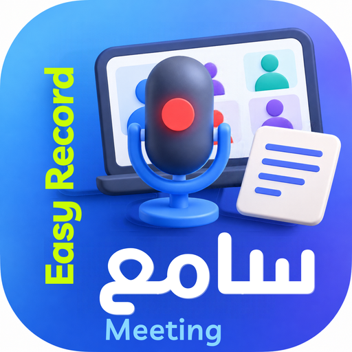
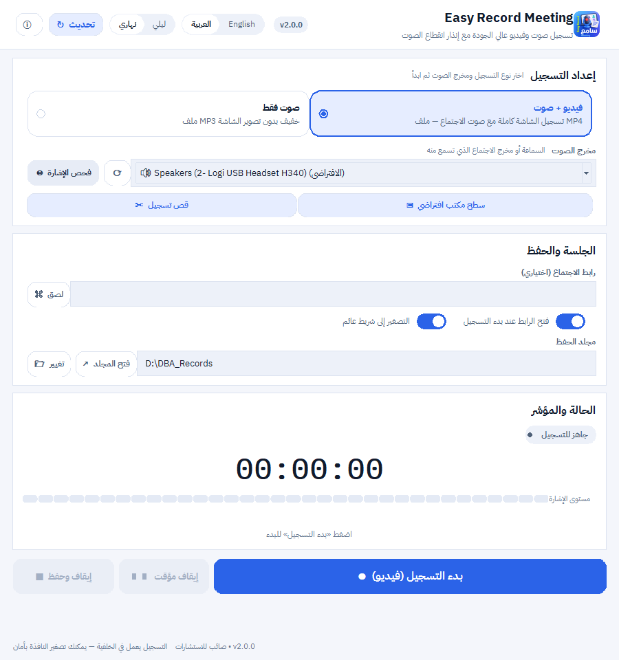
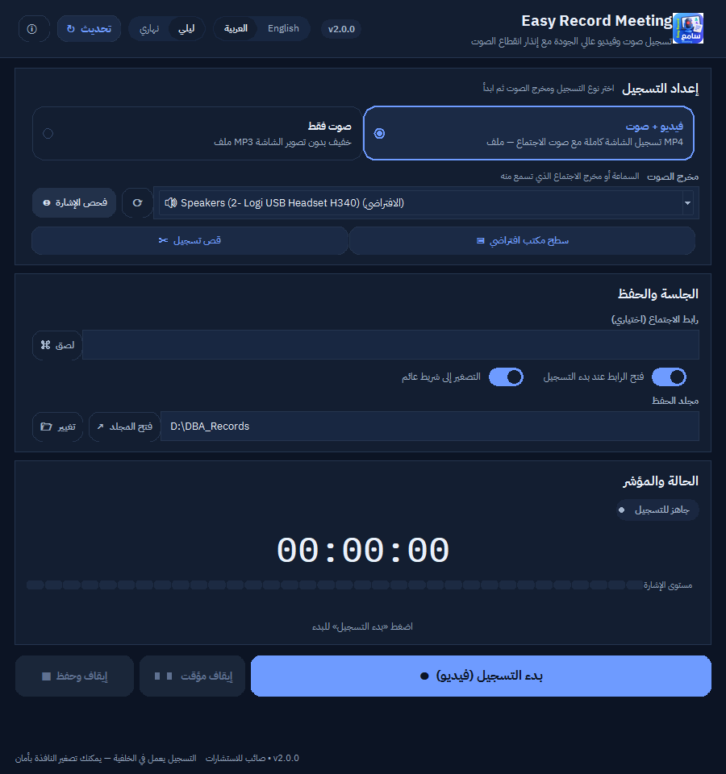
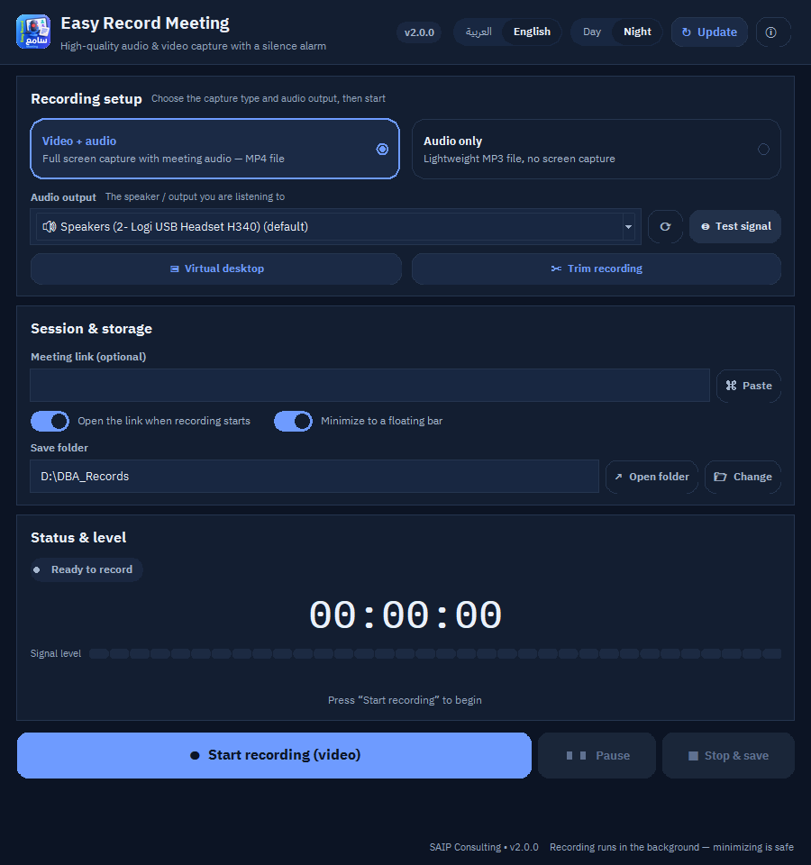
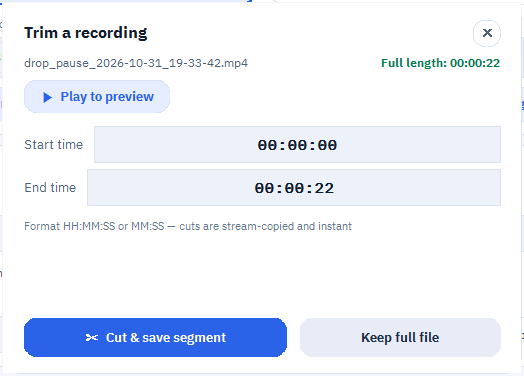
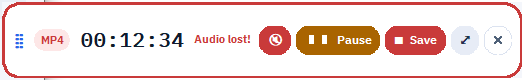

<p align="center">
  
</p>

<h1 align="center">Easy Record Meeting</h1>
<p align="center"><b>مسجّل الاجتماعات الذكي</b> · Smart meeting &amp; lecture recorder for Windows</p>

<p align="center">
  
  
  
  
  
</p>

<p align="center">
  <a href="#العربية">العربية</a> ·
  <a href="#english">English</a> ·
  <a href="docs/USER_GUIDE.md">دليل الاستخدام</a> ·
  <a href="reports/UX_UI_TEST.md">تقرير الواجهة</a>
</p>

---

<a id="العربية"></a>

## العربية

### ما هو البرنامج؟

**Easy Record Meeting** برنامج ويندوز محمول (لا يحتاج تثبيت) يسجّل **صوت الاجتماع من
مخرج السماعة نفسه** (Loopback) بجودة عالية، ويسجّل **الشاشة فيديو** عند الحاجة،
ثم يتيح **قص المقاطع فورًا** دون إعادة ترميز.

صُمِّم للاجتماعات والورش والمحاضرات التي تُقام على Webex / Teams / Zoom / Google Meet،
حيث يكون الصوت صادرًا من الجهاز لا من ميكروفون خارجي.

### لماذا يختلف؟

| الميزة | التفصيل |
|---|---|
| 🎙️ تسجيل صوت النظام | يلتقط ما تسمعه من السماعة عبر SoundCard Loopback — لا ميكروفون خارجي ولا تشويش الغرفة |
| 🔇 **إنذار انقطاع الصوت** | بعد 10 ثوانٍ صمت: تنبيه، وبعد 30 ثانية: وميض أحمر + نغمة، وزر كتم فوري |
| 🔁 **إعادة توصيل تلقائي للصوت** | إذا نام منفذ السماعة (USB/Bluetooth) وأخذ يعطي صمتًا رقميًا، يُعاد فتح المنفذ تلقائيًا ويُعلمك — ولن تُترك بصورة بلا صوت |
| 🛡️ **حرّاس (Watchdogs)** | تعليق قراءة الصوت أو موت ffmpeg لا ينهي التسجيل: يبدأ مقطع جديد فورًا ويكمل، والنتيجة ملف واحد متصل |
| 🎥 فيديو + صوت | تسجيل الشاشة MP4 (H.264 + AAC) بنفس نقرة واحدة |
| ✂️ قص فوري | Stream-copy داخل ffmpeg — قص ساعة في ثوانٍ |
| ⏸️ إيقاف مؤقت نظيف | يُوقف الصوت والفيديو معًا ويجمعهما بعد ذلك، فلا يحدث انفصال بين الصوت والصورة |
| 🌗 نهاري / ليلي | واجهة فاتحة أولًا، ووضع ليلي كامل |
| 🌍 عربي / إنجليزي | تبديل فوري مع اتجاه RTL كامل |
| 🔤 خطوط IBM Plex | مضمّنة داخل البرنامج (Sans Arabic + Sans + Mono) — تعمل على أي جهاز |
| ⬆️ تحديث من GitHub | زر يتحقق من آخر إصدار على GitHub ويقارنه بنسختك |
| 📌 شريط عائم | يبقى فوق كل النوافذ أثناء التسجيل، مع المؤقت والتنبيه وأزرار التحكم |

### لقطات الشاشة

| نهاري (عربي) | ليلي (عربي) |
|---|---|
|  |  |

| ليلي (إنجليزي) | قص التسجيل |
|---|---|
|  |  |

الشريط العائم: 

### التشغيل السريع

1. فك ضغط المجلد في أي مكان (يفضل قرص ثابت سريع).
2. شغّل **`تشغيل_البرنامج.bat`** أو **`OMAR_REC.exe`**.
3. (اختياري) `انشاء_اختصار_سطح_المكتب.bat` لإضافة أيقونة على سطح المكتب.

**داخل البرنامج:**

1. اختر **فيديو + صوت** أو **صوت فقط**.
2. اختر **مخرج الصوت** الصحيح (السماعة التي تسمع منها الاجتماع)، واضغط **فحص الإشارة** للتأكد.
3. اختر **مجلد الحفظ** (الافتراضي `D:\DBA_Records` وإن لم يوجد فمستندات المستخدم).
4. اضغط **بدء التسجيل** — وستبدأ النافذة بالتصغير إلى الشريط العائم افتراضيًا.
5. **إيقاف وحفظ** ← يسألك إن أردت قص مقطع، ثم يفتح مجلد الملف محددًا.

### شرح الأيقونة (كما في صورة الأيقونة)

الأيقونة تحكي وظيفة البرنامج بالكامل:

| العنصر في الأيقونة | المعنى |
|---|---|
| 🎙️ **الميكروفون الكبير في المنتصف** بإضاءة حمراء | التسجيل الجاري الآن — أحمر = تسجيل نشط |
| 💻 **شاشة الاجتماع بأربعة مشاركين** | تسجيل اجتماع/ورشة مباشرة من جهازك |
| 📝 **الورقة المسطّرة إلى اليمين** | التسجيل يُحفظ كملف منظم يمكن قصه ومشاركته |
| 🟦 **الخلفية الزرقاء الدائرية** | واجهة هادئة حديثة (نفس أزرق البرنامج `#2B63E8`) |
| ✳️ **كلمة `Easy Record` الرأسية بالليموني** | اسم المنتج ووعدُه: تسجيل بلا تعقيد |
| 🌐 **كلمة `اجتماع` ثم `Meeting`** | هوية ثنائية اللغة — عربي وإنجليزي في أيقونة واحدة |

الملف الأصلي: `Easy Record Meeting App Icon.png` (2000×2000) والأيقونة التنفيذية
`Easy Record Meeting App Icon.ico` (متعددة الأحجام 16→256).

### تحديث البرنامج من GitHub

اضغط زر **تحديث** في الشريط العلوي:

* يقرأ آخر إصدار من `api.github.com/repos/<owner>/easy-record-meeting/releases/latest`.
* إذا كان أحدث: يعرض رقم الإصدار وملاحظاته وزرًا لفتح صفحة الإصدارات.
* إذا كنت على الأحدث: رسالة تأكيد.
* بلا إنترنت: رسالة واضحة بالسبب، دون تعطيل البرنامج.

### الاختصارات

| الاختصار | الوظيفة |
|---|---|
| `Ctrl + R` | بدء / إيقاف التسجيل |
| `Ctrl + P` | إيقاف مؤقت / استئناف |
| `Ctrl + L` | تبديل اللغة (عربي ⇄ English) |
| `Ctrl + T` | تبديل المظهر (نهاري ⇄ ليلي) |
| `Ctrl + U` | التحقق من وجود تحديث |
| `F1` | نافذة «عن البرنامج» |

### البناء من المصدر

```bash
python -m venv .venv
.venv\Scripts\pip install -r requirements.txt pyinstaller
python omar_rec.py            # تشغيل من المصدر
build_exe.bat                 # بناء OMAR_REC.exe
```

### الاختبارات

```bash
.venv\Scripts\python -m unittest discover -s tests -t .
```

70 اختبارًا: أخطاء مُصلحة، انقطاع الصوت وإعادة التوصيل، تعدد اللغات، تباين الألوان، المحرّك، الواجهة، الأداء.

### كلمات مفتاحية

`مسجل اجتماعات` · `تسجيل صوت النظام` · `تسجيل الشاشة` · `تسجيل محاضرات` ·
`تسجيل ورش عمل` · `إنذار انقطاع الصوت` · `تسجيل Webex` · `تسجيل Teams` ·
`تسجيل Zoom` · `MP3` · `MP4` · `برنامج محمول` · `عربي` · `وضع ليلي` ·
`Windows 10` · `soundcard loopback` · `ar/EN`

---

<a id="english"></a>

## English

### What it is

**Easy Record Meeting** is a portable Windows app that records **the audio you
actually hear** — captured from the playback device via loopback, not from a room
microphone — optionally records the screen, and lets you trim segments instantly
with no re-encoding.

Built for meetings, workshops and lectures hosted on Webex, Teams, Zoom or Google
Meet, where the sound comes out of the machine.

### Why it is different

| Feature | Detail |
|---|---|
| 🎙️ System-audio capture | Loopback recording through SoundCard — no external mic, no room noise |
| 🔇 **Silence alarm** | 10 s of silence → warning; 30 s → flashing red border + beep + one-click mute |
| 🔁 **Automatic audio reconnect** | If a USB/Bluetooth endpoint sleeps and starts delivering digital silence, the stream is reopened and you are told — never a picture without sound |
| 🛡️ **Watchdogs** | A wedged audio read or a dead ffmpeg starts a fresh segment instead of ending the call; the result is still one continuous file |
| 🎥 Video + audio | Screen capture to MP4 (H.264 + AAC) in the same click |
| ✂️ Instant trim | ffmpeg stream-copy: cutting an hour takes seconds |
| ⏸️ Clean pause | Audio **and** video stop and are re-joined, so picture never drifts from sound |
| 🌗 Day / night | Light-first design with a complete dark theme |
| 🌍 Arabic / English | Instant switch with real RTL mirroring |
| 🔤 IBM Plex | Bundled (Sans Arabic + Sans + Mono) — identical on any PC |
| ⬆️ GitHub update | The button compares your build with the latest GitHub release |
| 📌 Floating bar | Stays on top while recording: timer, alarm, transport |

### Quick start

1. Unzip anywhere (an SSD is best).
2. Run **`تشغيل_البرنامج.bat`** or **`OMAR_REC.exe`**.
3. Pick **Video + audio** or **Audio only**.
4. Select the **audio output** you are listening to and press **Test signal**.
5. Choose the **save folder**, press **Start recording**.
6. **Stop & save** → optionally trim → the folder opens with the file selected.

### Icon explained

| Element | Meaning |
|---|---|
| 🎙️ Large centre microphone, red glow | Recording is live (red = active) |
| 💻 Laptop showing a four-person call | Capturing a real meeting from your PC |
| 📝 Lined note card on the right | The result is a tidy, trimmable file |
| 🟦 Rounded blue gradient | Calm, modern surface (the app's `#2B63E8`) |
| ✳️ Vertical lime “Easy Record” | Product name and promise: recording without fuss |
| 🌐 “اجتماع” + “Meeting” | Bilingual identity in a single mark |

### Build & test

```bash
python -m venv .venv
.venv\Scripts\pip install -r requirements.txt pyinstaller
python omar_rec.py
build_exe.bat
.venv\Scripts\python -m unittest discover -s tests -t .
```

### Keywords

`meeting recorder` · `system audio capture` · `loopback recorder` ·
`screen recorder` · `lecture recorder` · `workshop recorder` ·
`silence alarm` · `Webex recording` · `Teams recording` · `Zoom recording` ·
`MP3` · `MP4` · `portable Windows app` · `Arabic UI` · `dark mode` ·
`IBM Plex` · `tkinter` · `ffmpeg` · `ar/EN`

---

## Repository layout

```
omar_rec.py              entry point (DPI awareness, taskbar identity)
easyrec/
  app.py                 main window, polling, orchestration
  engine.py              recording engine (audio/video/pause/mux) — Tk-free, testable
  widgets.py             rounded buttons, toggles, segmented control, meter, cards
  theme.py               day/night design tokens + WCAG contrast maths
  i18n.py                Arabic/English strings (single source of truth)
  fonts.py               private IBM Plex registration
  dialogs.py             themed message, trim and About dialogs
  minibar.py             floating control bar
  updater.py             GitHub release check
  config.py              UTF-8, atomic settings persistence
assets/fonts/            11 IBM Plex TTFs (OFL)
assets/icon.ico|png      app + window icon
tests/                   70 automated tests
tools/                   perf probe, engine probe, screenshot generator
docs/                    user guide + screenshots
reports/                 bug / performance / UX test reports
legacy/                  untouched v1 source for reference
```

## License

MIT for this application. IBM Plex fonts are licensed under the SIL Open Font
License 1.1 (see `assets/fonts/`). ffmpeg is bundled separately under its own
license (GPL/LGPL build by gyan.dev).

**Author:** SAIP Consulting —· omaryounesEG
