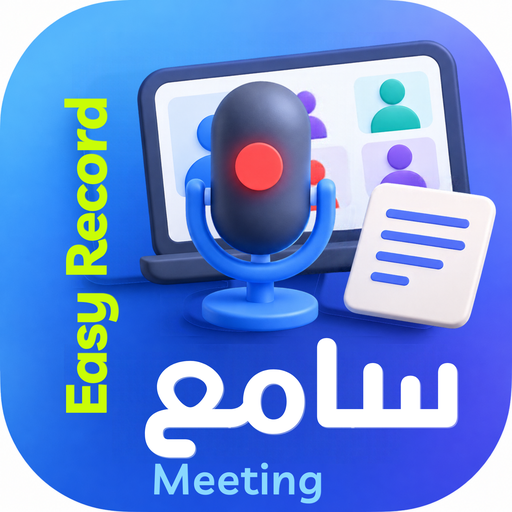
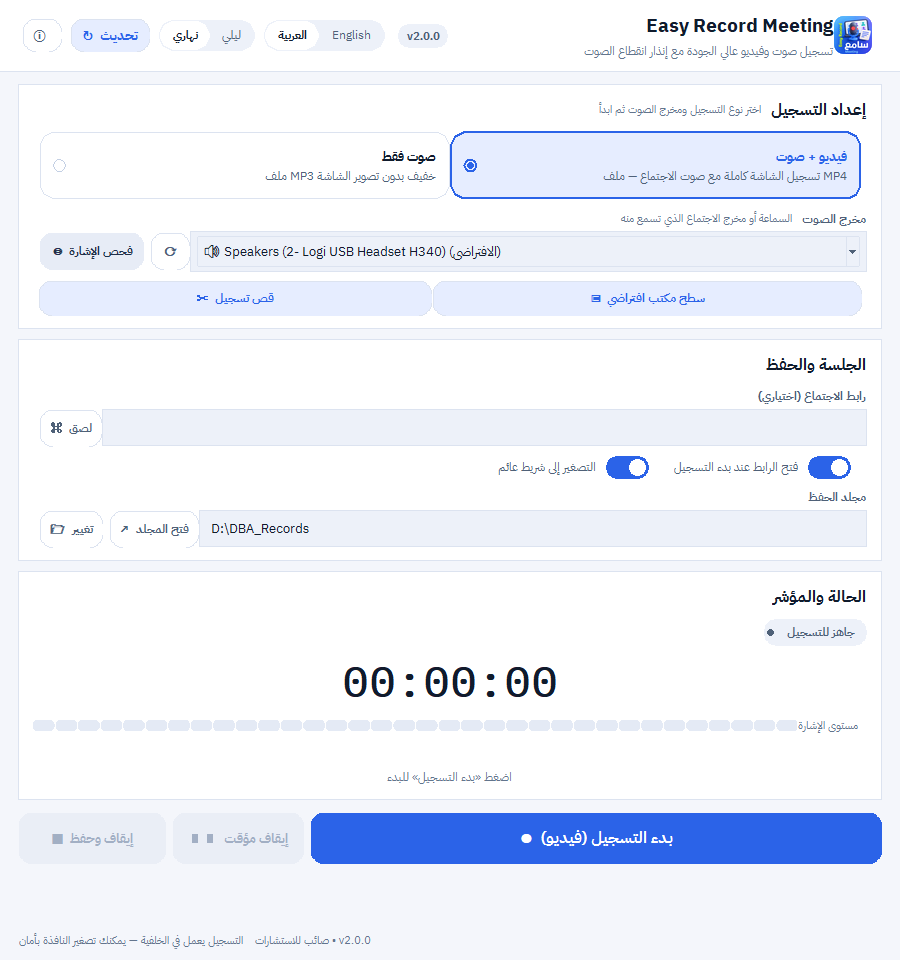
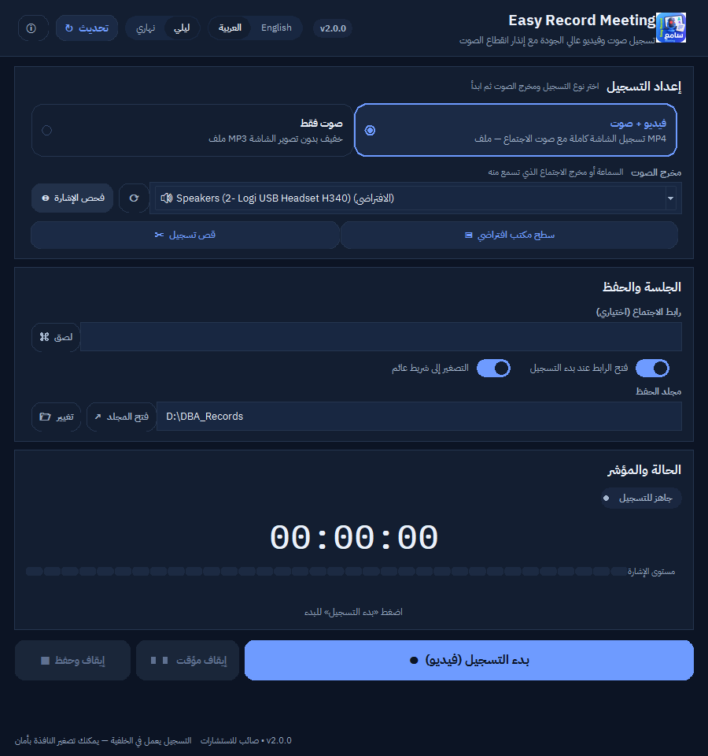
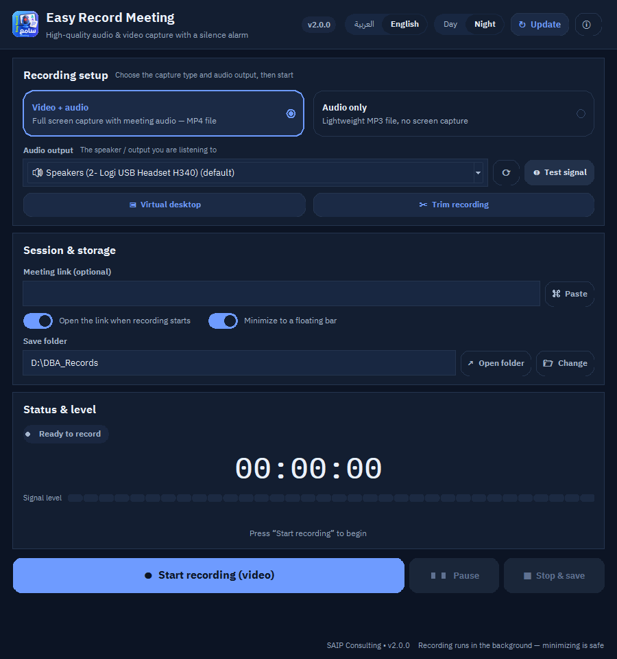
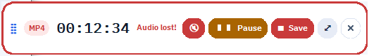

  

<h1 align="center">Easy Record Meeting</h1>

<b>مسجّل الاجتماعات الذكي</b> 
Smart meeting &amp; lecture recorder for Windows

  <b>مجاني</b> · <b>Free</b> &nbsp;|&nbsp; محمول بلا تثبيت &nbsp;|&nbsp; عربي / English &nbsp;|&nbsp; نهاري / ليلي

---

## العربية

### الاسم

**Easy Record Meeting** — «مسجّل الاجتماعات الذكي». برنامج ويندوز محمول يسجّل **الصوت الذي
تسمعه من السماعة نفسها** (System audio · Loopback) مع **الشاشة فيديو**، ويحفظ MP3 أو MP4،
ويقصّ المقاطع فورًا بدون إعادة ترميز.

### الميزات

| الميزة | التفصيل |
|---|---|
| 🎙️ تسجيل صوت الاجتماع | يلتقط مخرج الصوت مباشرة — بلا ميكروفون خارجي وبلا تشويش الغرفة |
| 🎥 فيديو + صوت | تسجيل الشاشة MP4 بجودة عالية بنفس النقرة |
| 🔇 إنذار انقطاع الصوت | تنبيه عند 10 ثوانٍ صمت، ووميض أحمر ونغمة عند 30 ثانية، مع كتم فوري |
| 🛡️ حماية متصلة | إعادة توصيل الصوت تلقائيًا إن نام منفذ السماعة، واستمرار التسجيل بلا انقطاع |
| ⏸️ إيقاف مؤقت نظيف | يوقف الصوت والفيديو معًا ويجمعهما فلا ينفصل الصوت عن الصورة |
| ✂️ قص فوري | قص أي مقطع في ثوانٍ (Stream copy) |
| 🌗 نهاري وليلي | واجهة فاتحة أولًا مع وضع ليلي كامل |
| 🌍 عربي وإنجليزي | تبديل فوري باتجاه RTL كامل |
| 🔤 خطوط IBM Plex | مضمّنة داخل البرنامج تعمل على أي جهاز |
| ⬆️ تحديث من GitHub | زر يفحص آخر إصدار ويخبرك بالجديد |
| 📌 شريط تحكم عائم | يبقى فوق كل النوافذ: المؤقت، التنبيه، وأزرار التحكم |

### الترخيص — مجاني

البرنامج **مجاني** للاستخدام الشخصي والتجاري تحت ترخيص **MIT**. خطوط IBM Plex بترخيص
SIL Open Font License 1.1، و`ffmpeg` بترخيصه الخاص (مضمّن مع الحزمة). لا اشتراك ولا مفتاح
تفعيل ولا حدود زمنية للتسجيل.

### التشغيل

1. فك ضغط الحزمة في مجلد واحد.
2. شغّل `OMAR_REC.exe` (ومعه `ffmpeg.exe`).
3. اختر نوع التسجيل ⇒ مخرج الصوت ⇒ **فحص الإشارة** ⇒ **بدء التسجيل**.

### من الأيقونة

🎙️ ميكروفون بإضاءة حمراء = تسجيل جارٍ · 💻 شاشة اجتماع بأربعة مشاركين = تسجيل مباشر من
جهازك · 📝 ورقة مسطّرة = ملف منظم قابل للقص · 🟦 خلفية دائرية = هوية البرنامج · 🌐 «اجتماع»
و«Meeting» = هوية ثنائية اللغة في علامة واحدة.

### صور من البرنامج

| نهاري (عربي) | ليلي (عربي) |
|---|---|
|  |  |

| ليلي (إنجليزي) | الشريط العائم |
|---|---|
|  |  |

### كلمات مفتاحية

مسجّل اجتماعات · تسجيل صوت النظام · تسجيل الشاشة · تسجيل محاضرات · تسجيل ورش عمل ·
تسجيل اجتماعات أونلاين · تسجيل Webex · تسجيل Teams · تسجيل Zoom · تسجيل Google Meet ·
إنذار انقطاع الصوت · MP3 · MP4 · برنامج محمول · ويندوز 10 · ويندوز 11 · واجهة عربية ·
وضع ليلي · مجاني

---

## English

### Name

**Easy Record Meeting** — a portable Windows recorder that captures **the sound you actually
hear** (system audio / loopback) together with the **screen**, saves MP3 or MP4, and trims
segments instantly without re-encoding.

### Features

| Feature | Detail |
|---|---|
| 🎙️ System-audio capture | Records the playback device directly — no external mic, no room noise |
| 🎥 Video + audio | Screen capture to MP4 in the same click |
| 🔇 Silence alarm | Warning after 10 s, flashing border and beep at 30 s, one-click mute |
| 🛡️ Uninterrupted recording | The audio stream reconnects automatically if the endpoint sleeps |
| ⏸️ Clean pause | Audio and video stop and re-join, so sound never drifts from picture |
| ✂️ Instant trim | Cut any segment in seconds (stream copy) |
| 🌗 Day &amp; night | Light-first interface with a complete dark theme |
| 🌍 Arabic &amp; English | Instant switch with full RTL mirroring |
| 🔤 IBM Plex | Bundled fonts — identical on any PC |
| ⬆️ GitHub updates | The button checks the latest release for you |
| 📌 Floating bar | Stays on top: timer, alarm, transport |

### License — free

**Free** for personal and commercial use under the **MIT** license. IBM Plex is licensed
under SIL OFL 1.1 and `ffmpeg` ships under its own license. No subscription, no activation
key, no recording time limit.

### Run

1. Unzip into one folder.
2. Start `OMAR_REC.exe` (keep `ffmpeg.exe` beside it).
3. Choose the capture type ⇒ audio output ⇒ **Test signal** ⇒ **Start recording**.

### The icon

🎙️ red-lit microphone = recording is live · 💻 four-person call on a laptop = capturing the
meeting from your PC · 📝 lined note = a tidy, trimmable file · 🟦 rounded blue field = the
product identity · 🌐 “اجتماع” + “Meeting” = one bilingual mark.

### Screenshots

| Day (AR) | Night (EN) |
|---|---|
|  |  |

### Keywords

meeting recorder · system audio recorder · loopback recorder · screen recorder ·
lecture recorder · workshop recorder · online meeting recorder · Webex recording ·
Teams recording · Zoom recording · Google Meet recording · silence alarm · MP3 · MP4 ·
portable Windows app · Windows 10 · Windows 11 · Arabic UI · bilingual · dark mode · free

---

  <code>EasyRecordMeeting-2.0.1-win64.zip</code> · 104,804,870 bytes 
  SHA-256 <code>836cc36ede14492e739e305bf46dc36dd6cf274b6f7f27c3f4d1716962c09a94</code>

---

  <b>SAIP Consulting — صائب للاستشارات</b> · omaryounesEG 
  <a href="https://github.com/omaryounesEG/easy-record-meeting#readme">README</a> ·
  <a href="https://github.com/omaryounesEG/easy-record-meeting/blob/main/docs/USER_GUIDE.md">دليل الاستخدام / User guide</a>

